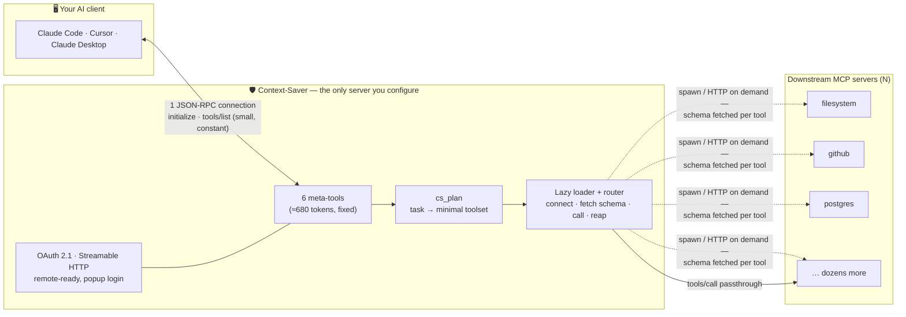
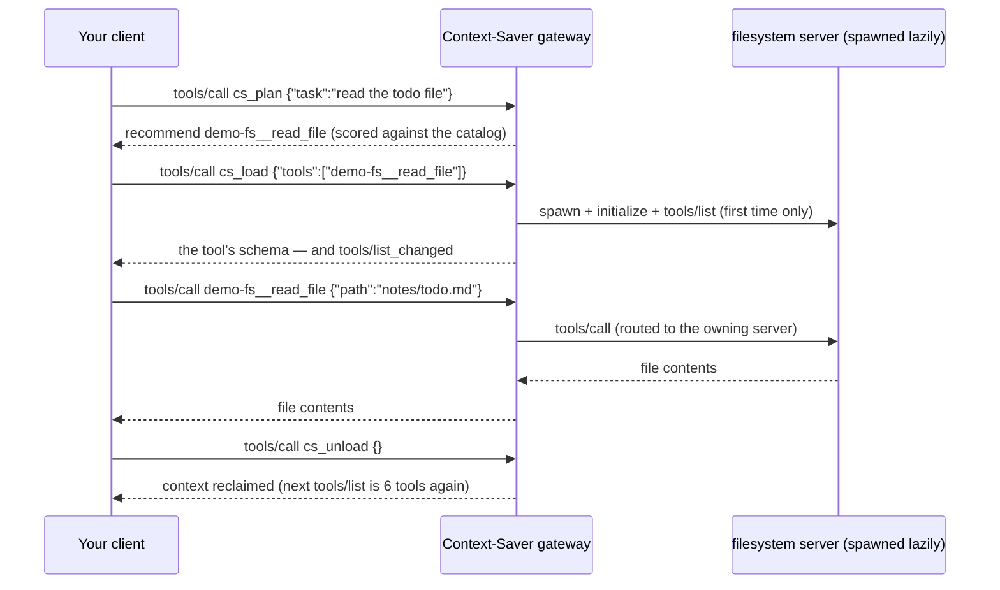

<!-- mcp-name: npm/context-saver-mcp -->
<div align="center">

# 🛡️ Context-Saver

**One MCP connection. Every tool. ~90% less context.**

*The token-saving gateway for the Model Context Protocol — lazy-load your
tool schemas instead of burning your context window on all of them, every
session, before you even type a word.*

[](.github/workflows/ci.yml)
[](https://www.npmjs.com/package/context-saver-mcp)
[](LICENSE)
[](package.json)
[](package.json)
[](context-saver.mjs)
[](https://github.com/renniyy/context-saver/issues?q=is%3Aissue+is%3Aopen+label%3A%22good+first+issue%22)

</div>

---

## 😫 The pain

You wire up 10 MCP servers to Claude Code or Cursor. It works — and then you
look at the token meter: **15k–20k tokens of tool schemas are loaded before
you type a single word.** Multiply by every session, every day. And with
dozens of barely-visible tools, the model starts *hallucinating workflows*
that don't exist. It's the top complaint in every "MCP is eating my context
window" thread.

Context-Saver flips the model: your client connects to **one** gateway whose
fixed footprint is **6 meta-tools (≈680 tokens)**. Tools from every
downstream server — filesystem, GitHub, Postgres, your scrapers — enter the
context **only for the turns that need them**, then leave.

| | Direct connections | With Context-Saver |
|---|---|---|
| Connections to configure | N (one per server) | **1** |
| Schemas in context, every session | all tools, always | **6 meta-tools + what this turn needs** |
| Tool discovery | none (or squinting at 40 names) | `cs_plan` / `cs_discover` |
| After the task is done | schemas stay, rent-free | `cs_unload` reclaims them |

---

## 🎬 See it work (60-second demo, no setup)


*A real `context-saver --demo --client` session: the gateway fronts 3 MCP
servers with 16 tools behind a fixed 6-tool surface; `cs_plan` picks the 2
tools the task needs, they're lazy-loaded, called, and the session ends
**70% lighter** than direct connections would have been.*

## ⏱️ Quick Start in 60 seconds

**1 — Run it with your existing MCP servers.** Point it at a config (it
accepts the exact same `mcpServers` block as your Claude config):

```bash
mkdir -p ~/.context-saver
cat > ~/.context-saver/config.json <<'EOF'
{
  "mcpServers": {
    "filesystem": { "command": "npx", "args": ["-y", "@modelcontextprotocol/server-filesystem", "~/projects"] },
    "github":     { "url": "https://api.githubcopilot.com/mcp/", "headers": { "Authorization": "Bearer ${GITHUB_TOKEN}" } }
  }
}
EOF
npx context-saver-mcp            # or: node context-saver.mjs
```

**2 — Configure exactly ONE server** in your client, instead of all of them:

<details>
<summary><b>Claude Code</b></summary>

```bash
claude mcp add context-saver -- npx -y context-saver-mcp
```
or in `~/.claude.json`:
```json
{
  "mcpServers": {
    "context-saver": { "command": "npx", "args": ["-y", "context-saver-mcp"] }
  }
}
```
</details>

<details>
<summary><b>Cursor</b> (<code>~/.cursor/mcp.json</code>)</summary>

```json
{
  "mcpServers": {
    "context-saver": { "command": "npx", "args": ["-y", "context-saver-mcp"] }
  }
}
```
</details>

<details>
<summary><b>Claude Desktop</b> (<code>claude_desktop_config.json</code>)</summary>

```json
{
  "mcpServers": {
    "context-saver": { "command": "npx", "args": ["-y", "context-saver-mcp"] }
  }
}
```
</details>

**3 — That's it.** Your model now sees `cs_discover`, `cs_plan`, `cs_load`,
`cs_call`, `cs_unload`, `cs_status` and uses them on its own. To verify
without any client:

```bash
npx context-saver-mcp --doctor     # end-to-end self-test, exit 0 = healthy
npx context-saver-mcp --demo --client   # interactive terminal client + demo servers
```

> Prefer to try before configuring anything? `--demo` spins up 3 built-in
> MCP servers (16 tools) with zero setup — the GIF above is exactly that.

---

## 🧠 How it works



<details>
<summary><b>What a single turn looks like on the wire</b></summary>


</details>

Higher-resolution diagram: [`docs/architecture.svg`](docs/architecture.svg).

The catalog (tool names, descriptions, schemas) is built once and cached on
disk, so `cs_discover` after a restart costs zero connections. Loading a tool
connects its owning server on demand, restarts it if it crashes, reaps it
when idle, and **snapshots its schema into your session** — surfaced as a
normal MCP tool via `notifications/tools/list_changed`, exactly like the spec
intends. `cs_call` even lets the model fire a one-off call with no schema at
all.

### The meta-tools

| Tool | What it does | Cost |
|---|---|---|
| `cs_discover` | Search the aggregated catalog across all servers (ids + one-liners, **no schemas**) | ~100 tok/result |
| `cs_plan` | Score the task text against the catalog → the minimal toolset, with reasons | ~150 tok/result |
| `cs_load` | Lazy-load tools (`"github:*"` globs work); schemas echoed + tools become callable | schemas, only now |
| `cs_call` | One-off direct call, auto-routes to the owning server, no schema loaded | ~the result |
| `cs_unload` | Reclaim context when the task is done | ~30 tok |
| `cs_status` | Servers, connections, live token-savings accounting | ~200 tok |

---

## 📉 The numbers

Token estimates use `ceil(JSON bytes / 4)` — the same heuristic your
tokenizer bill roughly follows. **Direct** = every tool definition (incl.
input schemas) present in `tools/list`; **gateway** = the 6 meta-tools plus
the definitions of tools loaded *for that task*.

| Setup | Direct (every session) | Context-Saver (6 meta + 2 loaded) | Saved |
|---|---:|---:|---:|
| **demo fleet — measured**¹: 3 servers · 16 tools | 2,261 tok | 817 tok | **63.9%** |
| 5 servers · ~40 tools² | ≈6,000 tok | ≈1,000 tok | ≈83% |
| 10 servers · ~120 tools² | ≈18,000 tok | ≈1,200 tok | ≈93% |
| 25 servers · ~300 tools² | ≈45,000 tok | ≈1,500 tok | ≈97% |

¹ *measured live by `cs_status` on the built-in demo; reproduce with
`npx context-saver-mcp --demo --client` then `/status`.*
² *projections computed with the same formula at ~150 tok/tool, the median
size of popular community MCP servers — not a benchmark, an estimate.*

The fixed floor is **2,704 bytes ≈ 676 tokens** for all 6 meta-tools
(`tools/list` payload, enforced by a test that fails if it exceeds 6 kB).

---

## 🌐 Remote mode: one URL, one pop-up, zero copy-pasted keys

Local stdio is the default. For a team or a VPS, run the same file as an HTTP
gateway with the embedded OAuth 2.1 authorization server — dynamic client
registration, PKCE, refresh tokens, and a login pop-up your MCP client opens
by itself (Claude Code and the official SDK clients discover it via
`/.well-known/oauth-protected-resource`):

```bash
node context-saver.mjs --transport http --port 3270 --host 0.0.0.0
# → MCP endpoint:  https://your-host:3270/mcp      (Streamable HTTP + legacy SSE)
# → login pop-up:  https://your-host:3270/authorize (OAuth 2.1 + PKCE)
```

<div align="center">

</div>

*The actual consent page served by the gateway (dark mode, PKCE-verified,
tokens in memory only).*

Safety rails: binding a non-loopback host **without** `--auth` is refused,
cross-origin browser requests are rejected, tokens are bearer-only and expire
(1 h default, refresh 30 d), the token endpoint is rate-limited, and all
redirect URIs must be HTTPS or loopback. Put it behind your favorite reverse
proxy for TLS — `--public-url` fixes the advertised metadata base.

---

## ⚙️ Configuration

One JSON file — searched in this order: `--config <path>` →
`$CONTEXT_SAVER_CONFIG` → `./context-saver.config.json` →
`~/.context-saver/config.json`. Both `servers` and Claude-style `mcpServers`
keys work, so you can paste your existing block directly:

```jsonc
{
  "servers": {                          // or "mcpServers" — identical meaning
    "filesystem": {
      "command": "npx",
      "args": ["-y", "@modelcontextprotocol/server-filesystem", "/home/me"],
      "env": { "SOME_VAR": "value" }   // ${ENV_VARS} are expanded
    },
    "github": {
      "url": "https://api.githubcopilot.com/mcp/",
      "headers": { "Authorization": "Bearer ${GITHUB_TOKEN}" }
    },
    "legacy-server": {
      "url": "https://old.example.com/sse",
      "transport": "sse"                 // legacy HTTP+SSE downstream
    },
    "flaky-internal": {
      "command": "./slow-server",
      "timeoutMs": 120000,              // per tools/call
      "idleMs": 60000                   // reap when unused this long
    },
    "disabled-one": { "command": "x", "disabled": true }
  },
  "defaults": { "timeoutMs": 60000 }
}
```

Every field is validated on startup with per-server, per-field error messages
(bad configs fail loudly, never silently).

### What happens when things break

| Failure | Behavior |
|---|---|
| Tool runs and fails | normal MCP result with `isError: true` — your agent keeps going |
| Downstream crashes mid-call | the call returns an error result; the server **respawns on the next call** |
| Downstream hangs | per-server `timeoutMs` (default 60 s) → error result with a hint |
| Downstream unreachable at startup | `cs_discover` still lists the (cached) catalog and marks it unreachable |
| A tool vanished after a config change | catalog fingerprint invalidates the cache automatically |
| You send garbage | proper JSON-RPC `-32700 / -32601 / -32602` errors, never a crash |

`npx context-saver-mcp --doctor` exercises all of this end-to-end and exits
non-zero on any failure — it's what CI runs on every commit.

---

## ❓ FAQ

**Is my model smart enough to use it?** Yes — the workflow is spelled out in
the `initialize` instructions Context-Saver sends (Claude Code and Cursor
honor it), and every meta-tool replies with the exact next command to run.
Worst case it behaves like a normal 6-tool MCP server.

**Does it spy on my prompts?** No. `cs_plan` receives only the text the model
chooses to send it. There is no logging of tool-call contents, and no
telemetry of any kind — the whole gateway is one offline file.

**What about prompts/resources from downstream servers?** Tools are fully
multiplexed; prompts and resources pass-through is on the
[roadmap](#-roadmap--good-first-issues) (the gateway advertises empty lists
in the meantime, as the spec allows).

**MCP registry?** Yes — [`server.json`](server.json) is published with every
release, and the README starts with an `mcp-name` marker.

---

## 🤝 Contributing & the Good First Issue pipeline

The **entire gateway is one readable file** — `context-saver.mjs` — with a
section index (`[01]`–`[16]`) at the top; every section is independently
testable and lands in the test suite. Zero dependencies means zero
supply-chain surface. Start with:

- [CONTRIBUTING.md](CONTRIBUTING.md) — 60-second dev setup (`npm test`), code map, review bar
- [`.github/GOOD_FIRST_ISSUES.md`](.github/GOOD_FIRST_ISSUES.md) — curated, scoped starter issues with exact file/line pointers
- [SCOPE.md](SCOPE.md) — what belongs here and documented precedent for what doesn't

Issue triage is automated: every new issue gets `needs-triage`; issues stuck
on `needs-info` for 14 days close automatically (a reply re-triages them).

## 🗺️ Roadmap & good first issues

| Feature | Where to start | Difficulty |
|---|---|---|
| Prompts & resources pass-through (`cs_list_resources`…) | engine `[08]`, mirror `hDiscover` | 🟢 good first issue |
| `--allowed-origin` / `--public-url` tests | `test/http-oauth.test.mjs` | 🟢 good first issue |
| Config `defaults` block coverage | `test/unit.test.mjs` → `loadConfig` | 🟢 good first issue |
| Streaming progress notifications passthrough | engine `_callDownstream` | 🟡 |
| Sampling/elicitation bridging to downstreams | `BaseDownstream._handleDownstreamNotification` | 🟡 |
| OpenTelemetry trace propagation | HTTP transport `[10]` | 🔴 |

## 🙏 Acknowledgments

Protocol behavior verified against the official
[TypeScript SDK](https://github.com/modelcontextprotocol/typescript-sdk).
README inspirations: [browser-use](https://github.com/browser-use/browser-use)
(real-task hero GIF), [Scrapling](https://github.com/D4Vinci/Scrapling)
(badge tiers, MCP registry packaging) and
[changedetection.io](https://github.com/dgtlmoon/changedetection.io)
(OAuth consent UX, budget discipline).

## ⚖️ License

[MIT](LICENSE) — one file, zero dependencies, copy it anywhere.
