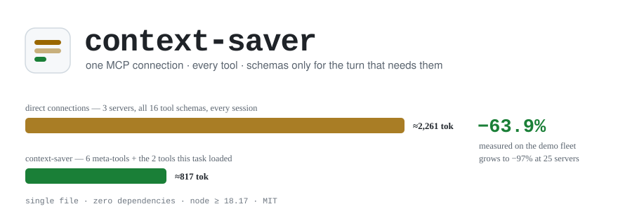
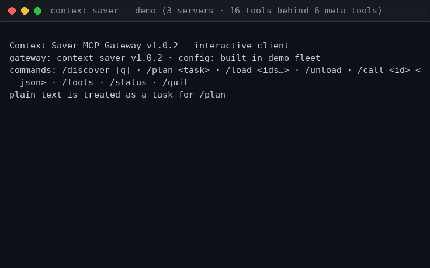
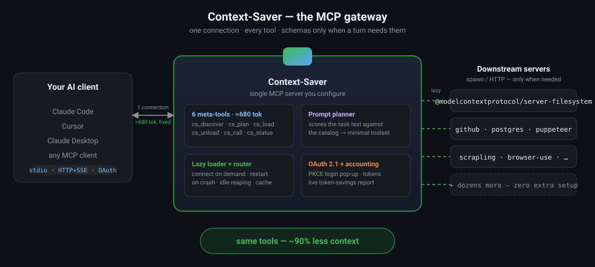
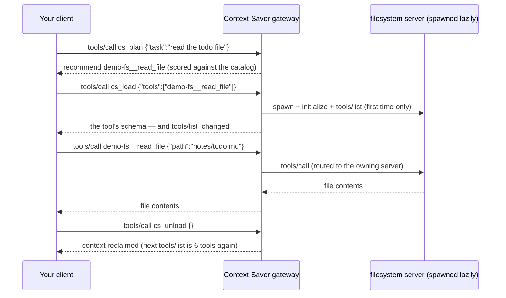
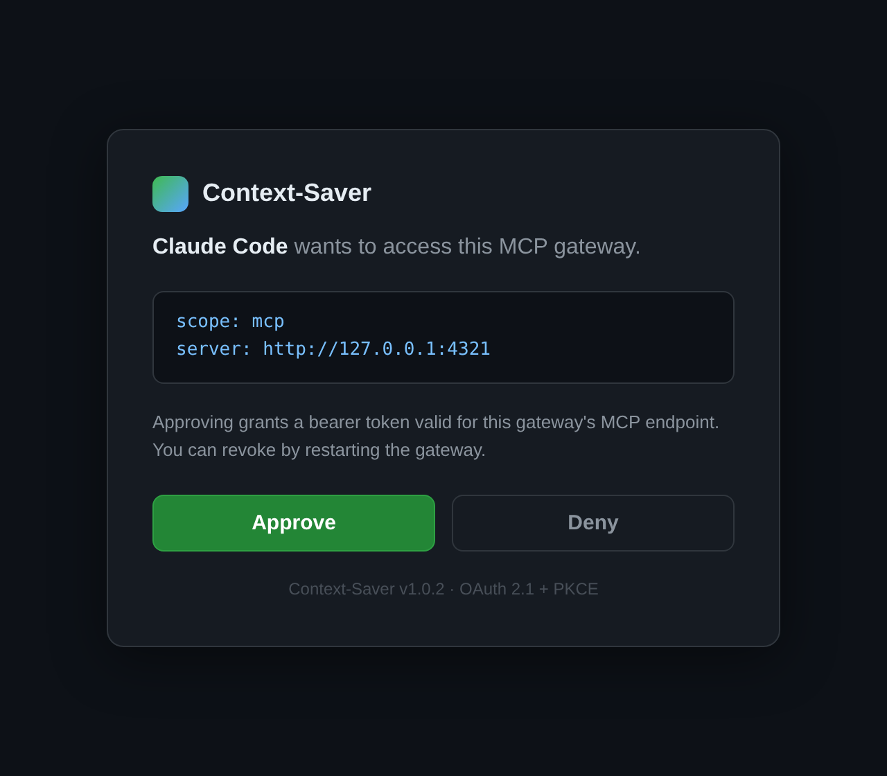

<!-- mcp-name: npm/context-saver-mcp -->

<picture>
  <source media="(prefers-color-scheme: dark)" srcset="docs/hero-dark.svg">
  
</picture>

&nbsp;

[](.github/workflows/ci.yml)
[](https://www.npmjs.com/package/context-saver-mcp)
[](package.json)
[](LICENSE)
[](https://github.com/renniyy/context-saver/issues?q=is%3Aissue+is%3Aopen+label%3A%22good%20first%20issue%22)

Wire up ten MCP servers to Claude Code or Cursor and then look at the token
meter: **15,000–20,000 tokens of tool schemas are sitting in your context
window before you type a single word** — every session, every day, whether
the task needs them or not. Half the tools are barely visible to the model,
and hallucinated workflows follow. It is the top complaint in every "MCP is
eating my context window" thread.

Context-Saver flips the arrangement. Your client connects to one
gateway whose fixed footprint is **6 meta-tools (2,704 bytes ≈ 676 tokens)**.
The tools from every downstream server — filesystem, GitHub, Postgres, your
scrapers — enter the context only for the turns that need them, then leave.

## Sixty seconds to running

**1 — Run the gateway with your existing MCP servers.** It accepts the exact
same `mcpServers` block as your Claude config:

```bash
mkdir -p ~/.context-saver
cat > ~/.context-saver/config.json <<'EOF'
{
  "mcpServers": {
    "filesystem": {
      "command": "npx",
      "args": ["-y", "@modelcontextprotocol/server-filesystem", "~/projects"]
    },
    "github": {
      "url": "https://api.githubcopilot.com/mcp/",
      "headers": { "Authorization": "Bearer ${GITHUB_TOKEN}" }
    }
  }
}
EOF
npx context-saver-mcp            # or: node context-saver.mjs
```

**2 — Configure exactly ONE server** in your client:

<details>
<summary>Claude Code</summary>

```bash
claude mcp add context-saver -- npx -y context-saver-mcp
```
or in `~/.claude.json`:
```json
{ "mcpServers": { "context-saver": { "command": "npx", "args": ["-y", "context-saver-mcp"] } } }
```
</details>

<details>
<summary>Cursor · Claude Desktop (same block, different file)</summary>

`~/.cursor/mcp.json` / `claude_desktop_config.json`:
```json
{ "mcpServers": { "context-saver": { "command": "npx", "args": ["-y", "context-saver-mcp"] } } }
```
</details>

**3 — Done.** Your model sees `cs_discover`, `cs_plan`, `cs_load`, `cs_call`,
`cs_unload`, `cs_status` and drives them on its own — the workflow is spelled
out in the `initialize` instructions the gateway sends. To verify with no
client at all:

```bash
npx context-saver-mcp --doctor          # end-to-end self-test, exit 0 = healthy
npx context-saver-mcp --demo --client   # interactive terminal client + 3 demo servers
```

> `--demo` spins up three built-in MCP servers (16 tools) with zero setup —
> the recording below is exactly that, captured from a real session.

## See it work



*Genuine gateway output (`--demo --client`, v1.0.2): the gateway fronts 3
servers / 16 tools behind 6 meta-tools. `cs_plan` picks the 2 tools the task
needs, they're loaded and called, and the session ends **63.9% lighter**
than direct connections would have been.*

## What your model sees

| Tool | What it does | Cost |
|---|---|---|
| `cs_discover` | Search the aggregated catalog — ids and one-liners, **no schemas** | ~100 tok/result |
| `cs_plan` | Score the task text against the catalog → the minimal toolset, with reasons | ~150 tok/result |
| `cs_load` | Lazy-load tools (`"github:*"` globs work) — schemas echoed, tools become callable | schemas, only now |
| `cs_call` | One-off call, auto-routes to the owning server, no schema loaded | ~the result |
| `cs_unload` | Reclaim the context when the task is done | ~30 tok |
| `cs_status` | Servers, connections, live token-savings accounting | ~200 tok |

## How it works



<details>
<summary>One turn, on the wire (sequence)</summary>


</details>

The catalog (tool names, descriptions, schemas) is built once and cached on
disk, so `cs_discover` after a restart costs zero connections. Loading a tool
connects its owning server on demand, restarts it if it crashes, reaps it
when idle, and surfaces its schema as a normal MCP tool via
`notifications/tools/list_changed` — the mechanism the spec built for exactly
this. `cs_call` fires a one-off call with no schema at all.

Protocol behavior is verified against the official
[TypeScript SDK](https://github.com/modelcontextprotocol/typescript-sdk)
(`2024-10-07` … `2025-11-25`).

## The numbers

Token estimates use `ceil(JSON bytes / 4)` — the heuristic your tokenizer
bill roughly follows. **Direct** = every tool definition (including input
schemas) in `tools/list`; **gateway** = the 6 meta-tools plus the
definitions loaded *for that task*.

| Setup | Direct (every session) | Context-Saver | Saved |
|---|---:|---:|---:|
| **demo fleet — measured**¹: 3 servers · 16 tools | 2,261 tok | 817 tok | **63.9%** |
| 5 servers · ~40 tools² | ≈6,000 tok | ≈1,000 tok | ≈83% |
| 10 servers · ~120 tools² | ≈18,000 tok | ≈1,200 tok | ≈93% |
| 25 servers · ~300 tools² | ≈45,000 tok | ≈1,500 tok | ≈97% |

¹ *measured live by `cs_status` — reproduce with
`npx context-saver-mcp --demo --client`, then `/status`. The fixed floor is
2,704 bytes ≈ 676 tokens for all 6 meta-tools, enforced by a test that fails
if the payload exceeds 6 kB.*
² *projections computed with the same formula at ~150 tok/tool, the median
size of popular community MCP servers — an estimate, not a benchmark.*

## Remote mode: one URL, one pop-up

Local stdio is the default. For a team or a VPS, run the same file as an
HTTP gateway with the embedded OAuth 2.1 authorization server — dynamic
client registration, PKCE, refresh tokens, and a login pop-up your MCP
client opens by itself (Claude Code and the official SDK clients discover it
via `/.well-known/oauth-protected-resource`):

```bash
node context-saver.mjs --transport http --port 3270 --host 0.0.0.0 \
  --approval-token <pairing-code-of-your-choosing>
# → MCP endpoint:  https://your-host:3270/mcp      (Streamable HTTP + legacy SSE)
# → login pop-up:  https://your-host:3270/authorize (OAuth 2.1 + PKCE)
```



*The actual consent page served by the gateway (dark mode, PKCE-verified,
tokens in memory only).*

Safety rails: binding a non-loopback host without `--auth` is refused, and
with `--auth` it also requires `--approval-token` (or
`CONTEXT_SAVER_APPROVAL_TOKEN`) — the consent page asks whoever signs in to
type it, because a consent page alone doesn't prove a human approved;
scripts can POST approvals directly, so the gateway refuses to start without
one (fail closed; `--insecure` to override). Cross-origin browser requests
are rejected, tokens are bearer-only and expire (1 h default, refresh 30 d),
the token endpoint is rate-limited, and redirect URIs must be HTTPS or
loopback. Put your favorite reverse proxy in front for TLS — `--public-url`
fixes the advertised metadata base. Docker: `docker run -e
CONTEXT_SAVER_APPROVAL_TOKEN=… context-saver` (see
[Dockerfile](Dockerfile)).

## Configuration

One JSON file, searched in this order: `--config <path>` →
`$CONTEXT_SAVER_CONFIG` → `./context-saver.config.json` →
`~/.context-saver/config.json`. Both `servers` and Claude-style `mcpServers`
work, so you can paste your existing block directly:

```jsonc
{
  "servers": {                          // or "mcpServers" — identical meaning
    "filesystem": {
      "command": "npx",
      "args": ["-y", "@modelcontextprotocol/server-filesystem", "/home/me"],
      "env": { "SOME_VAR": "value" }   // ${ENV_VARS} are expanded
    },
    "github": {
      "url": "https://api.githubcopilot.com/mcp/",
      "headers": { "Authorization": "Bearer ${GITHUB_TOKEN}" }
    },
    "legacy-server": {
      "url": "https://old.example.com/sse",
      "transport": "sse"                 // legacy HTTP+SSE downstream
    },
    "flaky-internal": {
      "command": "./slow-server",
      "timeoutMs": 120000,              // per tools/call
      "idleMs": 60000                   // reap when unused this long
    },
    "disabled-one": { "command": "x", "disabled": true }
  },
  "defaults": { "timeoutMs": 60000 }
}
```

Every field is validated on startup with per-server, per-field error
messages — bad configs fail loudly, never silently.

### When things break

| Failure | Behavior |
|---|---|
| Tool runs and fails | normal MCP result with `isError: true` — your agent keeps going |
| Downstream crashes mid-call | the call returns an error result; the server **respawns on the next call** |
| Downstream hangs | per-server `timeoutMs` (default 60 s) → error result with a hint |
| Downstream unreachable at startup | `cs_discover` still lists the (cached) catalog and marks it unreachable |
| A tool vanished after a config change | the catalog fingerprint invalidates the cache automatically |
| You send garbage | proper JSON-RPC `-32700 / -32601 / -32602` errors — and 4xx, not 500s, for malformed HTTP |

## Engineering receipts

Claims you can check yourself, in about a minute:

```bash
node context-saver.mjs --doctor      # 11 end-to-end checks; CI runs this on 3 OSes
npm test                             # 92 tests: unit + stdio E2E + HTTP/OAuth + adversarial audit probes
npm pack && tar -tzf context-saver-mcp-*.tgz   # one .mjs file, nothing else
```

- **One file, zero runtime dependencies.** The entire gateway is
  [`context-saver.mjs`](context-saver.mjs) (Node ≥ 18.17, built-ins only) —
  zero supply-chain surface, and a CI package-gate fails if the tarball ever
  grows a second file or a dependency.
- **Tests are the deliverable.** Every bug found in review landed with its
  failing-test-first reproduction ([`test/audit.test.mjs`](test/audit.test.mjs),
  two audit rounds, 10 fixes). CI runs the matrix on ubuntu/macOS/windows ×
  Node 18/20/22/24 and refuses version drift between the file and its
  metadata.
- **No telemetry, no prompt logging.** `cs_plan` receives only the text the
  model chooses to send it; the whole gateway is one offline file.

## Contributing

The code map, the review bar, and the 60-second dev setup are in
[CONTRIBUTING.md](CONTRIBUTING.md); scoped starter issues live on the
[good-first-issue board](https://github.com/renniyy/context-saver/issues?q=is%3Aissue+is%3Aopen+label%3A%22good+20first%20issue%22)
([`.github/GOOD_FIRST_ISSUES.md`](.github/GOOD_FIRST_ISSUES.md) has the
curated list with file/line pointers), and [SCOPE.md](SCOPE.md) documents
what belongs here — and precedent for what doesn't. Roadmap items worth
doing: prompts/resources pass-through, streaming progress passthrough,
sampling/elicitation bridging (all scoped in the GFI board).

Issue triage is automated: every new issue gets `needs-triage`; issues stuck
on `needs-info` for 14 days close automatically (a reply re-triages them).

## License

[MIT](LICENSE) — one file, zero dependencies, copy it anywhere.
